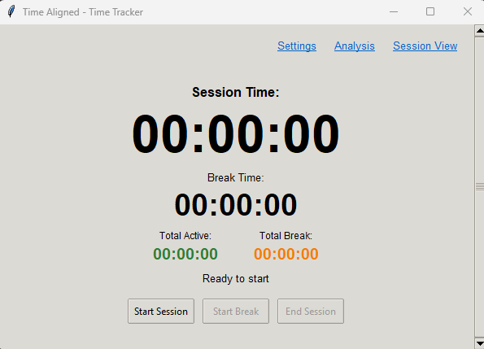

# Time Aligned - Time Tracker

     [](https://github.com/thesolwilder/Time_Aligned/releases/latest) 

A comprehensive time tracking desktop application built with Python, featuring session tracking, idle detection, Google Sheets integration, screenshot capture, and a full analysis suite.

## Download

**[→ Download the latest release](https://github.com/thesolwilder/Time_Aligned/releases/latest)**

1. Download `TimeAligned-vX.Y.Z.zip`
2. Extract it into a folder you can write to, such as `Documents`; this creates `Documents\TimeAligned`. Not `C:\Program Files`: the app keeps its data next to `TimeAligned.exe`
3. Run `TimeAligned.exe` (no installer, fully portable)

**Updating:** quit Time Aligned (tray icon → Quit), delete the old `_internal` folder, then copy the new `TimeAligned.exe` and `_internal` into the same folder. Your `data.json`, `settings.json` and `backups` stay as they are.

> **Chrome blocks the download?** Click the downloads arrow → flag icon → **Keep anyway**  
> **Windows SmartScreen warning?** Click **More info → Run anyway**  
> The exe is unsigned but safe. Verify at [VirusTotal](https://www.virustotal.com) if unsure.

---

| Home                                    | Active Session                                               |
| --------------------------------------- | ------------------------------------------------------------ |
|  |  |

## Features

### Core Tracking

- **Session Tracking**: Start, pause, and end work sessions
- **Editable History**: Edit past sessions. Update sphere, project, action, and other fields at any time
- **Secondary Projects**: Tag any period (active, break, or idle) with a secondary project/action and a time percentage for more accurate tracking
- **Break Management**: Track breaks separately from active work time
- **Idle Detection**: Automatically detect when you're away from your computer (optional, with a configurable threshold). It can also start a break automatically after a set time, or never; an automatic break keeps running until you end it
- **Multiple Spheres & Projects**: Organize your work into categories and projects
- **Note Taking**: Add notes on both individual periods and overall sessions
- **Global Hotkeys** _(off by default)_: Turn them on in Settings → Global Keyboard Shortcuts to start (Ctrl+Shift+S), take a break (Ctrl+Shift+B) or end a session (Ctrl+Shift+E), and show/hide the window (Ctrl+Shift+W), even while it's hidden in the system tray. They work in every program, so they also fire when another app uses the same keys (Ctrl+Shift+E opens the Explorer in VS Code)
- **Crash-Safe Saving & Backups**: Saves continuously during a session. Every save goes to a temporary file that is then swapped in, so a crash or a full disk can't empty `data.json`. The first save each day keeps a daily backup in `backups/` (the 14 most recent are kept), a copy is made before a session is deleted, and a `data.json` that can't be read is set aside instead of overwritten
- **One Copy at a Time**: Starting the app while it's already running (for example, hidden in the tray) shows "already running" instead of starting a second copy

### Customizable Settings

- Manage, archive, and set defaults for spheres, projects, and break actions (auto-populated in session and analysis frames)
- Record goals for projects and notes for actions
- Configure idle detection thresholds and automatic breaks
- Opt in for screenshot capture
- Turn global keyboard shortcuts on or off
- Connect to Google Sheets by pasting your spreadsheet's URL or ID and choosing your Google credentials file
- Export all data to CSV for local storage

### Screenshot Capture

- Optional screenshot capture during sessions, never between sessions
- Captures when you switch windows, or on a timer, at most once every N seconds (configurable)
- Helps you remember what you were working on

| Screenshot During Session                                                     | Captured Screenshot Folders                                           |
| ----------------------------------------------------------------------------- | --------------------------------------------------------------------- |
|  |  |

### Google Sheets Integration

- Uploads a session when you click **Save & Complete** or **Skip** on the completion screen (one row per active, break and idle period)
- Saving a session again (for example after editing it) **replaces** its rows instead of adding duplicates
- Anything that didn't upload (you were offline, closed the app on the completion screen, or hit an error) is **retried** at your next save and shortly after the app starts
- A session is uploaded once it ends, not while you're still tracking it. Switching to another spreadsheet or tab re-sends every session
- Never opens a Google sign-in on its own: if Google needs you to sign in again, you get a warning and sign in with **Test Connection**
- Easy to analyze with Google Sheets tools

### Analysis Tools

- View session history and statistics
- Analyze time spent across different projects
- Review screenshots from past sessions
- **Sortable columns**: Sort session history by any header
- Export filtered data for focused analysis: narrow down by date, sphere, project, or action
- **Dynamic text wrapping**: All comments display with proper word wrapping
- **Paginated loading**: Loads 50 periods at a time for optimal performance
- **Efficiency pie chart**: Visual breakdown of active vs break time for the current filter

| Analysis Overview                                             | Filtered with Secondary Data                                          |
| ------------------------------------------------------------- | --------------------------------------------------------------------- |
|  |  |

### Security Measures

- **Input sanitization**: Sphere, project and break action names added in Settings are sanitized to strip dangerous characters (path traversal, injection attempts, control characters)
- **Formula injection prevention**: Project and action names, comments and notes are escaped before Google Sheets upload to prevent spreadsheet formula execution
- **Google API input validation**: Spreadsheet IDs and sheet names are validated before any API call; an invalid ID is rejected, and an invalid tab name is replaced by "Sessions"
- **Credential file path validation**: The credentials file path is checked for traversal patterns (`..`, `~`, `%`, `${`) before use
- **Sensitive files protected**: `credentials.json`, `token.pickle`, `settings.json`, and `data.json` are gitignored

## Installation (from source)

1. Clone or download this repository
2. Install dependencies (Python 3.10+):
   ```bash
   pip install -r requirements.txt
   ```
3. Run the application:
   ```bash
   python time_tracker.py
   ```

When run from source, the data files are created in the folder you start it from. The built `TimeAligned.exe` always uses its own folder.

## Google Sheets Setup

To enable automatic upload to Google Sheets:

1. Follow the detailed setup guide in [GOOGLE_SHEETS_SETUP.md](docs/GOOGLE_SHEETS_SETUP.md)
2. Download your credentials from Google Cloud Console and save them as `credentials.json` next to `TimeAligned.exe`
3. In Settings → Google Sheets, paste the spreadsheet's URL, enter a tab name, and choose the credentials file
4. Click **Test Connection** and sign in to Google in the browser window that opens
5. Check **Enable automatic upload to Google Sheets** and click **Save Google Sheets Settings**. Test Connection alone doesn't turn uploads on

> If your Google Cloud app is in **Testing** mode, Google asks you to sign in again every 7 days. When the app warns you, sign in again with Test Connection; sessions saved in the meantime upload at your next save or the next time the app starts.

## Usage

### Starting a Session

1. Click "Start Session"
2. Work on your task

### Taking Breaks

- Click "Start Break" when you need a break
- The app will track break time separately
- Idle detection can automatically start breaks (Settings → Idle; choose **Never** to turn this off). An automatic break keeps running until you end it

### Ending a Session

1. Click "End Session". Defaults are automatically applied to the session data
2. Review and label your activities
3. Add notes about what you accomplished
4. Click **Save & Complete**, or **Skip** to keep the defaults. Either one uploads the session to Google Sheets if that's enabled

Closing the window during a session offers to end the session and quit. That skips the completion screen, so the session keeps its default labels.

| Session Completion                                                | Secondary Project Tagging                                           |
| ----------------------------------------------------------------- | ------------------------------------------------------------------- |
|  |  |

### Settings

Access settings to configure:

- Idle detection thresholds and automatic breaks
- Screenshot capture options
- Global keyboard shortcuts (off by default)
- Google Sheets integration
- Spheres and projects
- Break actions

| Spheres & Projects                                                | Keyboard Shortcuts                                                               | Google Sheets                                                                   |
| ----------------------------------------------------------------- | -------------------------------------------------------------------------------- | ------------------------------------------------------------------------------- |
|  |  |  |

| Idle Detection                                                 | Break Actions                                                                   | Screenshot Settings                                                       | Data Export                                                                         |
| -------------------------------------------------------------- | ------------------------------------------------------------------------------- | ------------------------------------------------------------------------- | ----------------------------------------------------------------------------------- |
|  |  |  |  |

## Data Storage

Everything is stored next to `TimeAligned.exe` (or, when running from source, in the folder you start it from):

| File / folder            | What it holds                                                                  |
| ------------------------ | ------------------------------------------------------------------------------ |
| `data.json`              | All your sessions                                                              |
| `settings.json`          | Your settings, spheres, projects and break actions                             |
| `backups/`               | Daily backups of `data.json` (14 most recent) and copies made before deletions |
| `screenshots/`           | Screenshots, organized by date and session (only if enabled)                   |
| `credentials.json`       | Your Google Cloud credentials (only if you use Google Sheets)                   |
| `token.pickle`           | Your saved Google sign-in (keep it private)                                    |
| `sheets_upload_log.json` | Which sessions have been uploaded to Google Sheets                             |

- **Google Sheets**: Optional copy of your sessions in your own spreadsheet

## Performance Characteristics

### Timeline Loading

The analysis timeline uses **dynamic text height calculation** to ensure all comment text is visible with proper word wrapping:

- **Initial Load**: ~3.5-4 seconds for 50 periods (first page)
- **Load More**: ~1-2 seconds per additional 50 periods
- **Trade-off**: Prioritizes **accurate text display** over faster loading

**Why this design?**

Users click "Show Timeline" specifically to **review data** - this is an intentional action where they expect to spend time analyzing information. The 3-4 second load ensures:

All comment text is fully visible (no truncation)  
Proper word wrapping for readability  
Consistent layout across all text fields  
Accurate height calculation (not estimation)

This is a deliberate engineering decision prioritizing **data quality and usability** over arbitrary speed targets.

### Code Design Philosophy

This codebase values **readability, maintainability, and test coverage**. Architecture decisions prioritise clear, linear logic for sequential workflows and pragmatic refactoring, improving code where it has meaningful impact rather than for its own sake.

## Roadmap

- **Timeline redesign** _(priority)_: Replace tkinter-based timeline with a more capable technology to overcome widget limitations
- **UI refresh**: Update the front-end visual design
- **Goal tracking**: Add goal tracking within the analysis frame
- **LLM analysis** _(optional)_: AI-assisted analysis of session data
- **Multi-user support**: Different user logins
- **Mobile-friendly**: Cross-platform / mobile support

## Privacy & Security

- All data is stored locally by default
- Google Sheets integration is opt-in. Uploaded rows include your sphere and project names, notes and comments
- Screenshots are stored locally only (not uploaded)
- `token.pickle` can access your Google spreadsheets, so don't share the app folder; share a CSV export instead
- Your credentials files are protected (see `.gitignore`)

## Files Overview

```
time_tracker.py                  # Application entry point
src/
  analysis_frame.py              # Analysis and reporting UI
  completion_frame.py            # Session completion interface
  settings_frame.py              # Settings UI
  google_sheets_integration.py   # Google Sheets upload and sync
  file_safety.py                 # Crash-safe saving and daily backups
  screenshot_capture.py          # Screenshot functionality
  ui_helpers.py                  # Shared UI utilities and sanitization
  constants.py                   # App-wide constants
docs/                            # Full documentation
tests/                           # Full test suite
```

## Documentation

- [About / Release Notes](docs/ABOUT.md) - What Time Aligned is and what's included
- [Google Sheets Setup Guide](docs/GOOGLE_SHEETS_SETUP.md) - Complete setup instructions
- [Screenshot Feature Guide](docs/SCREENSHOT_FEATURE.md) - Screenshot feature details
- [System Tray Guide](docs/SYSTEM_TRAY_GUIDE.md) - Using the system tray icon
- [Testing Guide](docs/TESTING_GUIDE.md) - Running tests

## Requirements

- Windows 10 or 11
- Python 3.10+ to run from source (tested on 3.13 and 3.14); the downloadable `.exe` needs no Python
- See `requirements.txt` for Python package dependencies
- See `requirements-dev.txt` for dev/build dependencies (pytest, coverage, PyInstaller)

## Contributing

Contributions are welcome! Please see:

- **[DEVELOPMENT.md](DEVELOPMENT.md)** - Development standards and testing procedures
- **[.github/COPILOT_INSTRUCTIONS.md](.github/COPILOT_INSTRUCTIONS.md)** - AI-assisted development workflow

This project uses a **documented AI-assisted development workflow**. The `.github/COPILOT_INSTRUCTIONS.md` file defines standing orders for AI coding agents (covering TDD requirements, forbidden patterns, and code quality standards) so that any contributor (human or AI) works consistently within the same conventions. `DECISION_LOG.md` serves as a decision log, recording what approaches were tried, what worked, and why, similar to Architecture Decision Records (ADRs).

This project follows **Test-Driven Development (TDD)**:

1. Import test → 2. Unit tests → 3. Integration tests → 4. E2E tests

The test suite has **83% code coverage** across the core application. All contributions must include appropriate tests. See DEVELOPMENT.md for details.

Run the full suite with coverage from the project folder:

```powershell
python -W ignore -m coverage run tests/run_all_tests.py
python -m coverage report
```

The one test that signs in to the real Google API is skipped unless you set `RUN_REAL_GOOGLE_API_TESTS=1`.

## License

This project is licensed under the **Creative Commons Attribution-NonCommercial 4.0 International (CC BY-NC 4.0)** license.

- Free to use for personal, non-commercial purposes
- Free to modify and share with attribution
- Commercial use is not permitted without explicit written permission

See the [LICENSE](LICENSE) file for full details, or visit [creativecommons.org/licenses/by-nc/4.0](https://creativecommons.org/licenses/by-nc/4.0/).

## Changelog

### v1.0.2

- Crash-safe saving: a crash or full disk can no longer empty `data.json`; daily backups (14 kept); an unreadable `data.json` is set aside instead of overwritten
- Google Sheets: uploads on **Save & Complete** and **Skip**; saving a session again replaces its rows instead of duplicating them; missed uploads are retried at the next save and when the app starts; never opens a sign-in window by itself
- Fixed: automatic break set to **Never** started a break as soon as you went idle
- Global keyboard shortcuts are now **off by default**; turn them on in Settings → Global Keyboard Shortcuts
- Only one copy of the app can run at a time
- The `.exe` always keeps its data next to itself, whichever shortcut starts it
- No screenshots are taken between sessions

### v1.0.0 to v1.0.1

- Added Google Sheets integration for automatic session upload
- Sessions automatically append to the same spreadsheet
- Secure OAuth 2.0 authentication with Google
- Secondary project tagging: assign a secondary project/action and time percentage to any period
- Editable history: update sphere, project, action, and fields on past sessions
- Global hotkeys: start, break, and end sessions without opening the window; system tray support for headless operation
- Auto backup: continuous saves during sessions; backup file created on session deletion
- CSV export: download all session data for local storage and analysis
- Analysis improvements: sortable columns, active vs break pie chart, paginated loading, and filter-scoped exports
- Security hardening: input sanitization, path traversal prevention, and formula injection protection
